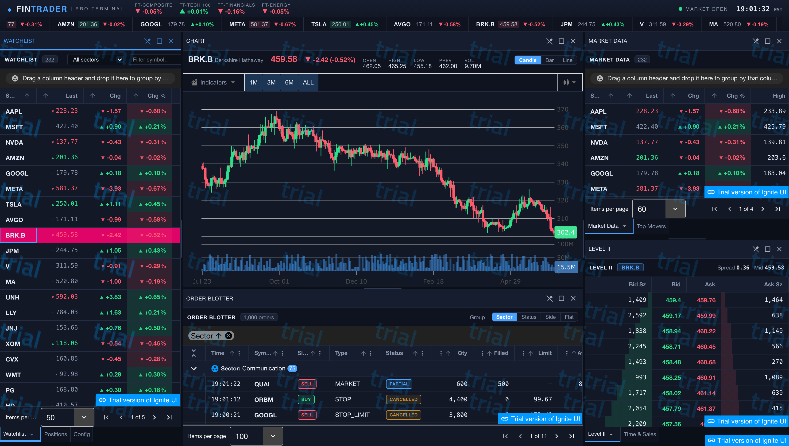
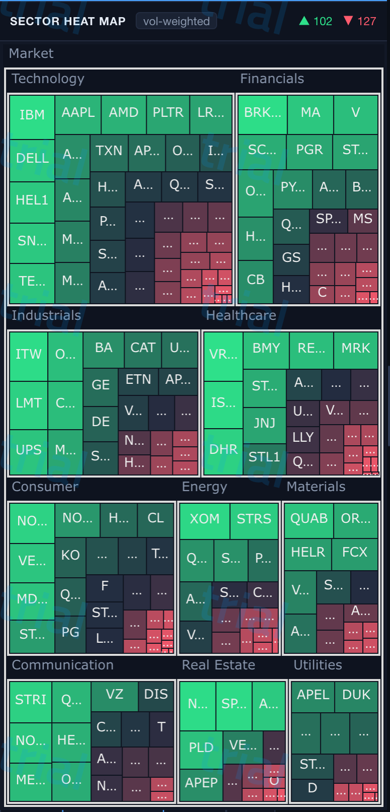

# FinTrader Pro — A Real‑Time Dark‑Mode Trading Workstation Built with React 19 + Ignite UI for React

> **TL;DR** — FinTrader Pro is an open, mock‑data **trading terminal** built entirely with **[Ignite UI for React](https://www.infragistics.com/products/ignite-ui-react)**. It combines a dockable multi‑pane workspace (`IgrDockManager`), a candlestick **financial chart** (`IgrFinancialChart`), a finviz‑style **sector heat‑map** (`IgrTreemap`), and six high‑density **data grids** (`IgrGrid`) — a 232‑symbol watchlist, a 1,000‑row order blotter, Level II depth, Time & Sales, positions, and market movers — all wired to a shared, streaming live‑feed context and a runtime theming engine (Light/Dark × Material/Bootstrap/Fluent/Indigo, plus density). Everything is linked: click a symbol anywhere and the chart, order book, and tape follow.



<p align="center">
  <em>A dense, dark, fully theme‑cohesive financial trading UI — 100% Ignite UI for React components, mock data only.</em>
</p>

<p align="center">
  <strong>🚀 <a href="https://react-grids.github.io/react-stock-trader-app/">Live demo</a></strong>
</p>

<p align="center">
  <a href="https://react-grids.github.io/react-stock-trader-app/"></a>
  
  
  
  
  
</p>

---

## Table of Contents

- [What is FinTrader Pro?](#what-is-fintrader-pro)
- [Why build a trading terminal with Ignite UI for React?](#why-build-a-trading-terminal-with-ignite-ui-for-react)
- [Quick start](#quick-start)
- [Feature tour](#feature-tour)
- [Architecture at a glance](#architecture-at-a-glance)
- [The theming engine (the hard part)](#the-theming-engine-the-hard-part)
- [Taming the financial chart](#taming-the-financial-chart)
- [The live‑feed + linked‑selection state model](#the-live-feed--linked-selection-state-model)
- [Tech stack](#tech-stack)
- [Project structure](#project-structure)
- [Performance & accessibility](#performance--accessibility)
- [Known limitations](#known-limitations)
- [FAQ](#faq)
- [Recreate this project from scratch](#recreate-this-project-from-scratch)
- [License](#license)

---

## What is FinTrader Pro?

**FinTrader Pro is a front‑end reference application that recreates the look and feel of a professional equities trading workstation** (think Bloomberg Terminal, Thinkorswim, or a sell‑side OMS) using only **Ignite UI for React** components and **mock market data**. It is a showcase for building **data‑dense, real‑time financial dashboards** in **React 19** with **TypeScript** and **Vite**.

It answers a question developers ask constantly: *"How do I build a Bloomberg‑style trading dashboard in React with dockable panels, candlestick charts, and fast data grids that all stay in sync and on‑theme?"* This repository is a complete, working answer.

**Core capabilities:**

- 🪟 **Dockable workspace** — drag, float, pin, tab, and resize every panel via `IgrDockManager`.
- 📈 **Candlestick chart** — OHLC + volume + range selector via `IgrFinancialChart`.
- 🟩🟥 **Sector heat‑map** — a finviz‑style `IgrTreemap`: tiles grouped by sector, sized by volume, colored red→green by % change, click‑to‑select.
- 🔢 **Six live data grids** — watchlist (232 symbols), positions, order blotter (1,000 orders), market data, top movers, Level II depth, and Time & Sales.
- 🔴🟢 **Conditional cell styling** — green/red coloring with trend arrows on change, % change, and P&L.
- 🔗 **Linked selection** — pick a symbol in any grid and the chart, Level II, and tape update instantly.
- 📡 **Streaming feed** — a ~1‑second mock tick engine drives a flashing ticker marquee and live grid updates.
- 🎨 **Runtime theming** — switch Light/Dark × Material/Bootstrap/Fluent/Indigo and density at runtime, with full theme cohesion across grids, chart, dock chrome, and scrollbars.

---

## Why build a trading terminal with Ignite UI for React?

Financial UIs are one of the most demanding categories of front‑end work: huge row counts, sub‑second updates, dense layouts, conditional formatting, and zero tolerance for visual inconsistency. **[Ignite UI for React](https://www.infragistics.com/products/ignite-ui-react)** ships the three hard components you'd otherwise spend months building:

| Need | Ignite UI component | Package |
| --- | --- | --- |
| Dockable, floating, tabbed layout | `IgrDockManager` | `igniteui-react-dockmanager` |
| Candlestick / OHLC / volume chart | `IgrFinancialChart` | `igniteui-react-charts` |
| Sector / market heat‑map | `IgrTreemap` | `igniteui-react-charts` |
| Virtualized data grid w/ grouping, paging, conditional styles | `IgrGrid`, `IgrColumn`, `IgrPaginator` | `igniteui-react-grids` |

This project leans on all three and adds the application‑level glue: a shared market‑data context, a linked selected‑symbol model, and a theming layer that makes every surface match.

---

## Quick start

**Try it now:** a live build is hosted on GitHub Pages at **<https://react-grids.github.io/react-stock-trader-app/>** — no install required.

**Prerequisites:** Node.js 20+ and npm.

```bash
# 1. Install dependencies
npm install

# 2. Start the dev server (opens http://localhost:3003)
npm start

# 3. Production build
npm run build

# 4. Preview the production build
npm run preview
```

That's it — no API keys, no backend. **All data is generated client‑side from a seeded PRNG**, so the universe is stable across reloads.

---

## Feature tour

### Top bar — streaming ticker, indices, and market clock

A fixed header renders the **FINTRADER** brand, four synthetic indices (FT‑Composite, FT‑Tech 100, FT‑Financials, FT‑Energy) computed live from sector aggregates, a market‑status pulse, and a live clock. Below it, a **scrolling ticker marquee** streams 56 symbols and **flashes green/red on every price change** — implemented by keying each price `<span>` on its value so only changed items re‑trigger the flash animation. Click any ticker item to jump the whole workspace to that symbol. Hover pauses the marquee.

### Left column — Watchlist · Sector Map · Positions · Config (tabbed)

- **Watchlist** — 232 symbols in an `IgrGrid` with a sector filter, symbol search (debounced with `useDeferredValue`), 50‑rows‑per‑page paging, sortable columns, **tick‑direction coloring on Last**, and **arrowed green/red change / % change** via `cellStyles`.
- **Sector Map** — a finviz‑style **`IgrTreemap` heat‑map** (see below).
- **Positions** — an open‑position book **grouped by sector** with live mark‑to‑market, day P&L, and unrealized P&L roll‑ups in the toolbar.
- **Config** — runtime theme controls (see [theming](#the-theming-engine-the-hard-part)).

#### Sector heat‑map (`IgrTreemap`)



The Sector Map is a **finviz‑style market heat‑map** built on `IgrTreemap`:

- **Two‑level hierarchy** — symbols grouped under their sector via `idMemberPath` / `parentIdMemberPath`, with sector header bands and drill‑down.
- **Sized by volume** — `valueMemberPath` weights each tile by trading volume (snapshotted once so the layout stays stable while colors update live).
- **Colored by performance** — `fillScaleMode="Value"` maps each symbol's % change onto a **red → neutral → green** brush scale (`fillBrushes`) anchored at ±3%, using the same gain/loss tokens as the rest of the app.
- **Linked + live** — clicking a tile (`nodePointerPressed`) sets the shared selected symbol; the fill recolors with the ~1s feed (throttled to ~3s so drill‑in stays navigable).

<br clear="all">


### Center column — Candlestick chart over the Order Blotter

- **Chart** — `IgrFinancialChart` in `Candle` / `Bar` / `Line` modes with a quote header (last, change, OHLC, prev close, volume), volume pane, and a range selector (1M/3M/6M/ALL). Bullish/bearish candles use the app's gain/loss tokens; the plot background matches the pane.
- **Order Blotter** — **1,000 orders** in a grid that can be **grouped by Sector / Status / Side / flat**, with **100‑per‑page paging**, Excel‑style filtering, and colored **side** (BUY/SELL) and **status** (FILLED/PARTIAL/WORKING/CANCELLED/REJECTED) pills.

### Right column — Market Data / Top Movers · Level II / Time & Sales (tabbed)

- **Market Data** — the full 232‑symbol quote board with paging.
- **Top Movers** — gainers / losers / most‑active views.
- **Level II** — a depth‑of‑book ladder rendered as a *real* `IgrGrid` (not a div ladder), with **green bid / red ask** coloring and **cumulative‑depth bars drawn via `cellStyles` linear‑gradient backgrounds**, plus spread/mid in the header.
- **Time & Sales** — a streaming print tape colored by aggressor side (lift‑the‑offer = green, hit‑the‑bid = red).

---

## Architecture at a glance

```
┌──────────────────────────────────────────────────────────────────────┐
│ TopBar  (brand · synthetic indices · clock · streaming ticker marquee) │
├───────────────┬──────────────────────────────────┬────────────────────┤
│  Watchlist    │            Chart                 │   Market Data /     │
│  Sector Map   │   (IgrFinancialChart, candle)    │   Top Movers (tabs) │
│  Positions    │                                  ├────────────────────┤
│  Config (tabs)├──────────────────────────────────┤   Level II /        │
│  ▲ IgrTreemap │   Order Blotter (grouped grid)   │   Time & Sales(tabs)│
└───────────────┴──────────────────────────────────┴────────────────────┘
         All panes are IgrDockManager content panes (drag / float / pin / tab)

   <ThemeProvider>            ← runtime Light/Dark × palette × density
     <MarketProvider>         ← seeded universe + ~1s tick engine + selection
       <Workstation/>         ← IgrDockManager layout + all panes
```

Two React contexts power everything:

- **`ThemeProvider`** swaps the active Ignite UI stylesheets and palette attributes at runtime.
- **`MarketProvider`** owns the seeded data universe, the live tick loop, and the shared **selected symbol**.

---

## The theming engine (the hard part)

Theme cohesion across an entire trading terminal is genuinely difficult, because Ignite UI grids, the Dock Manager, and the chart each expose **different theming surfaces**. FinTrader Pro solves this in two layers:

**1. A runtime stylesheet registry** ([`src/theme/themeRegistry.ts`](src/theme/themeRegistry.ts)) imports all **8 web‑components themes + 8 grid themes** through Vite's `?url` loader and swaps the active `<link href>` at runtime. `applyTheme(variant, palette, size)` swaps both stylesheets, sets `data-variant` / `data-palette` on `<html>`, sets the `--ig-size` density token, and toggles the Dock Manager's `dark-theme` / `light-theme` class.

**2. A single semantic palette** ([`src/theme/palette.css`](src/theme/palette.css)) keyed on `[data-variant]` and `[data-palette]` that maps **every** themable token to one source of truth:

- Grid tokens: `--ig-grid-background`, `--ig-grid-content-background`, `--ig-grid-row-odd/even-background` (kept **identical — no zebra**), `--ig-grid-header-background`, `--ig-grid-row-hover-background`, and more.
- Dock tokens: the full `--igc-*` family (pane headers, tabs, splitters, context menus, joysticks).
- Native + dock scrollbars (`--igc-sb-*` and `::-webkit-scrollbar`) — palette‑matched, no bright‑blue defaults.
- Gain/loss/flash colors consumed by both CSS and the canvas chart.

A subtle but important detail: **the theme is applied during render (via `useMemo`), not in an effect.** An effect runs *after* descendants render, which would leave the canvas chart reading stale CSS variables for one frame on every theme switch. Applying in render keeps the chart's resolved colors in lock‑step with the rest of the UI.

---

## Taming the financial chart

`IgrFinancialChart` renders in **two completely different layers**, and theming each correctly is the trickiest part of the whole app:

1. **Canvas‑painted plot, volume, and zoom navigator** — themable *only* through chart **props** (`brushes`, `negativeBrushes`, `outlines`, `volumeBrushes`, `overlayBrushes`, …). Because canvas can't read CSS variables, [`useThemeColors`](src/theme/useThemeColors.ts) resolves the palette CSS vars to concrete values and the chart converts them to `rgba()`.
2. **Light‑DOM HTML toolbar, range selector, type/indicator menus, and legend** — shipped with a **hard‑coded light theme** (`.financialChart*`, `.ui-*` classes). These are **re‑skinned with scoped CSS** in [`src/components/ui.css`](src/components/ui.css), *not* with props.
3. **The zoom‑slider navigator's shade and handles have no color API** — so rather than ship an off‑theme white scrollbar, the slider is **disabled** (`zoomSliderType="None"`) and range selection is kept via the toolbar.

This three‑pronged approach (props for canvas, scoped CSS for the toolbar, disable what can't match) is the reusable lesson for theming Ignite UI charts in any dark app.

---

## The live‑feed + linked‑selection state model

[`src/state/MarketContext.tsx`](src/state/MarketContext.tsx) is the heart of the app:

- **Seeded universe** — 232 instruments across 10 sectors, generated from a deterministic `mulberry32` PRNG so data is stable across reloads.
- **~1s tick engine** — a `setInterval` mutates a random subset of quotes plus the selected symbol every second, recomputing change/%/bid/ask/volume and a tick direction used for flashing.
- **Linked selection** — a single `selected` symbol string is shared by every pane. Clicking a row in the Watchlist, Positions, or Market Data grid (`onRowClick → e.detail.row.data`) updates the chart, Level II book, and Time & Sales tape together.
- **Derived live views** — positions are re‑valued each tick; the Level II book re‑centers on the selected quote; the tape prepends a new print each tick.

Data generators live in [`src/data/`](src/data/): `symbols.ts` (universe), `generators.ts` (quotes, positions, 1,000 orders, candles, order book, prints), `rng.ts` (PRNG), and `types.ts` (the domain model).

---

## Tech stack

- **[React 19.2](https://react.dev/)** — function components, `use()` context hook, `useDeferredValue`, document metadata, ref‑as‑prop, context‑without‑Provider.
- **[TypeScript 5.9](https://www.typescriptlang.org/)** — strict mode, `verbatimModuleSyntax`, discriminated unions for the order/position model.
- **[Vite 8](https://vite.dev/)** — dev server + build; `?url` CSS imports power the runtime theme swap.
- **[Ignite UI for React 19.7](https://www.infragistics.com/products/ignite-ui-react)** — `igniteui-react`, `igniteui-react-grids`, `igniteui-react-charts`, `igniteui-react-dockmanager`.
- **[React Router 7](https://reactrouter.com/)** — app shell routing.
- **[Vitest](https://vitest.dev/) + Playwright** — testing and visual verification.

---

## Project structure

```
src/
├─ main.tsx                     # module registration, theme CSS imports, providers
├─ app/
│  └─ home/home.tsx             # route → <Workstation/>
├─ theme/
│  ├─ themeRegistry.ts          # runtime stylesheet swap (8 wc + 8 grid themes)
│  ├─ palette.css               # the cohesion layer (grid/dock/chart/scrollbar tokens)
│  ├─ ThemeContext.tsx          # variant/palette/size state (applied in render)
│  └─ useThemeColors.ts         # resolve CSS vars → concrete colors for the canvas chart
├─ data/
│  ├─ types.ts                  # Quote, Position, Order, OrderBook, Print, Candle
│  ├─ rng.ts                    # mulberry32 seeded PRNG
│  ├─ symbols.ts                # 232-symbol universe across 10 sectors
│  └─ generators.ts             # quotes, positions, 1,000 orders, candles, book, prints
├─ state/
│  └─ MarketContext.tsx         # live feed (~1s) + linked selected-symbol
└─ components/
   ├─ Workstation.tsx           # IgrDockManager layout + all panes
   ├─ TopBar.tsx                # ticker marquee + indices + clock
   ├─ Watchlist.tsx             # IgrGrid (search, filter, paging, arrows)
   ├─ Positions.tsx             # IgrGrid grouped by sector
   ├─ ChartPane.tsx             # IgrFinancialChart (candle/bar/line)
   ├─ SectorMap.tsx             # IgrTreemap sector heat-map (volume × %change)
   ├─ OrderBlotter.tsx          # IgrGrid (grouping, paging, pills)
   ├─ MarketGrid.tsx            # market data / top movers
   ├─ LevelII.tsx               # depth ladder as an IgrGrid (gradient depth bars)
   ├─ TimeAndSales.tsx          # streaming print tape
   ├─ ConfigPane.tsx            # theme + density switches
   ├─ ui.css                    # app chrome + financial-chart re-skin
   └─ grid/cellRenderers.tsx    # shared formatters, cellStyles, arrow templates
```

---

## Performance & accessibility

- **Virtualized grids** — `IgrGrid` virtualizes rows, so 232‑row and 1,000‑row grids stay smooth under a 1‑second update cadence.
- **Targeted re‑renders** — the tick loop mutates a subset of quotes and updates only the panes that need it; the chart re‑binds on selection (not every tick) to preserve zoom.
- **Debounced search** — `useDeferredValue` keeps the watchlist filter responsive.
- **Semantic + keyboard** — native `<button>`/`<select>`/`<input>` controls, ARIA labels on the ticker, clock, and search; the Dock Manager ships full keyboard docking/navigation.

---

## Known limitations

- **Trial watermark** — this project uses the **trial** Ignite UI packages (`igniteui-react-grids`, `igniteui-react-charts`, `igniteui-react-dockmanager`), so a small *"Trial version of Ignite UI"* badge appears on the grids and chart. Swapping to the licensed `@infragistics/*` packages removes it.
- **Mock data only** — there is no backend, websocket, or real market feed; the tick engine is a client‑side simulation.
- **Build note** — CSS minification is disabled in [`vite.config.ts`](vite.config.ts) because a shipped vendor grid‑theme stylesheet contains a token that the lightningcss minifier rejects.

---

## FAQ

**Is this a real trading platform?**
No. FinTrader Pro is a **UI reference application with simulated data**. It places no orders and connects to no exchange.

**How do I build a Bloomberg‑style trading dashboard in React?**
Use a dock manager for the layout (`IgrDockManager`), a financial chart for candlesticks (`IgrFinancialChart`), and a virtualized data grid for tables (`IgrGrid`), then share a single "selected symbol" via React context so every pane stays linked. This repo is a complete example.

**Which chart should I use for candlestick / OHLC data in React?**
`IgrFinancialChart` from `igniteui-react-charts`. It renders OHLC candlesticks, a volume pane, indicators, and a range selector out of the box.

**How do I color grid cells green/red based on value in Ignite UI?**
Use the `cellStyles` property on `IgrColumn` — an object of style‑name → callback `(rowData, columnKey, cellValue, rowIndex) => value`. FinTrader Pro centralizes this in `src/components/grid/cellRenderers.tsx`.

**How do I switch Ignite UI themes (Material/Bootstrap/Fluent/Indigo, light/dark) at runtime?**
Import each theme stylesheet via Vite's `?url` loader and swap the active `<link href>`, then drive component tokens from a single CSS palette keyed on data attributes. See [`src/theme/themeRegistry.ts`](src/theme/themeRegistry.ts) and [`src/theme/palette.css`](src/theme/palette.css).

**Can I group and page an Ignite UI grid at the same time?**
Yes — set `groupingExpressions` on `IgrGrid` and add an `IgrPaginator` child. The Order Blotter does both with 1,000 rows.

**How do I build a stock market heat‑map (treemap) in React?**
Use `IgrTreemap` from `igniteui-react-charts`. Bind a flat hierarchy with `idMemberPath` / `parentIdMemberPath`, size tiles with `valueMemberPath`, and color them by a metric with `fillScaleMode="Value"` + `customValueMemberPath` + a `fillBrushes` red→green scale. The Sector Map pane is a complete example. **Gotcha:** give parent/root nodes *no* `value` so the treemap sums their children — an explicit `0` collapses the layout.

**Does it work with React 19?**
Yes. The app is built on React 19.2 and uses the `use()` hook for context, document metadata, and ref‑as‑prop patterns.

---

## Recreate this project from scratch

Want to build this yourself (or have an AI agent build it)? A complete, copy‑pasteable specification — the exact prompt, requirements, acceptance criteria, and component‑by‑component breakdown — lives in:

### 👉 [`docs/RECREATE-PROMPT.md`](docs/RECREATE-PROMPT.md)

It documents the full brief, the strict styling acceptance criteria, the data requirements (232 symbols, 1,000 orders), and the Ignite UI APIs used, so you can reproduce FinTrader Pro step by step.

---

## License

MIT for the application code in this repository. **Ignite UI for React is a commercial Infragistics product** — the trial packages used here are subject to Infragistics' trial license. See [infragistics.com/products/ignite-ui-react](https://www.infragistics.com/products/ignite-ui-react) for licensing.

---

<p align="center">
  Built with ❤️ and <a href="https://www.infragistics.com/products/ignite-ui-react">Ignite UI for React</a> · Mock data only · Not investment advice.
</p>
